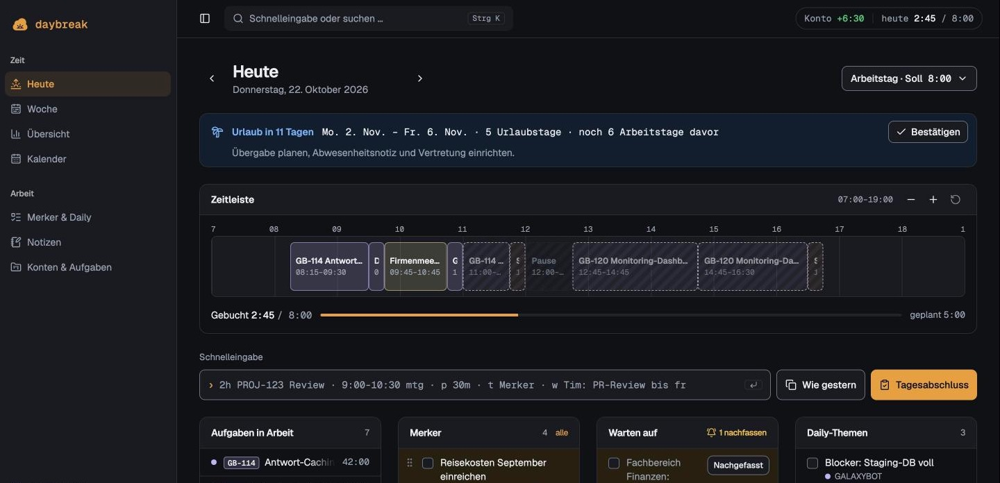
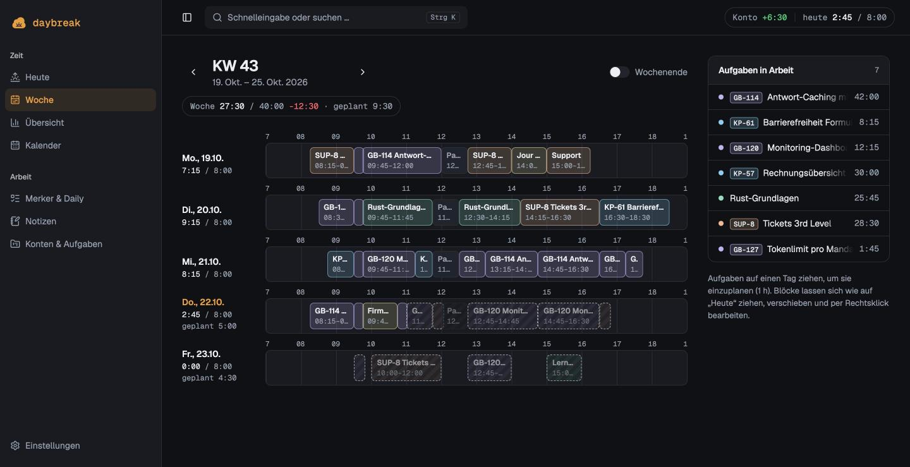
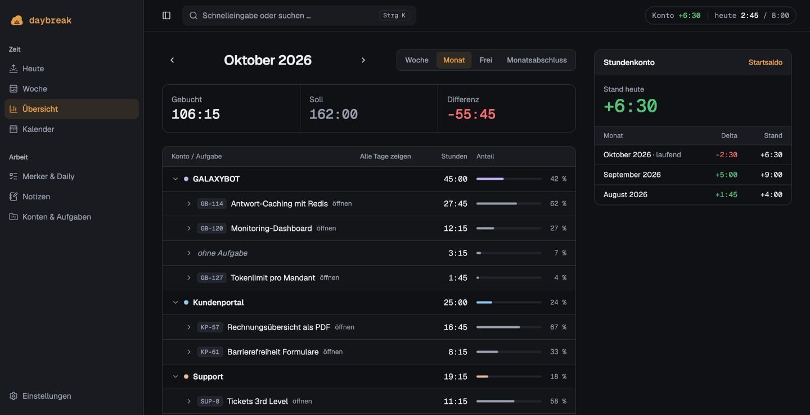

<h1 align="center">☀️ daybreak</h1>

<p align="center">
  <strong>Persönliches Arbeits-Dashboard: Zeit planen und buchen, Stundenkonto, Urlaub, Merker und Notizen an einem Ort.</strong><br>
  Single-User · selbst gehostet · eine SQLite-Datei
</p>

<p align="center">
  <a href="https://github.com/SleepyPxnda/daybreak/actions/workflows/ci.yml"></a>
  <a href="https://github.com/SleepyPxnda/daybreak/releases"></a>
  <a href="https://github.com/SleepyPxnda/daybreak/pkgs/container/daybreak"></a>
  <a href="LICENSE"></a>
</p>



Daybreak ersetzt Zettel, Excel-Stundenzettel und die drei Notiz-Apps, die man sonst nebeneinander offen hat. Morgens den Tag planen, tagsüber per Tastatur buchen, abends den Tag abschließen – und am Monatsende stehen die Stunden pro Konto fertig zum Übertragen ins Firmentool bereit.

> [!NOTE]
> Die Oberfläche ist auf Deutsch, Feiertage kommen aus [feiertagejs](https://github.com/sfakir/feiertagejs) (Bundesland wählbar).

## Funktionen

- **Heute** – Tages-Timeline im 15-Minuten-Raster: Blöcke ziehen, planen, buchen, teilen; „Wie gestern“ und Tagesabschluss.
- **Schnelleingabe** (`Strg+K` / `⌘K`) – buchen, planen, Merker anlegen, suchen und navigieren per Kurzbefehl, z. B. `2h GB-114 Review`, `9:00-10:30 mtg`, `plan 3h KP-57 morgen`.
- **Konten & Aufgaben** – Konto → Aufgabe → Blöcke; Blöcke können auch direkt auf ein Konto gehen (z. B. Firmenmeeting). Aufgaben mit Key, Schätzung und gebuchter Zeit.
- **Vorlagen** – wiederkehrende Termine (Daily, Jour fixe …) mit Wochentagen, Intervall und Ausnahmen.
- **Stundenkonto** – Soll/Ist/Saldo je Tag, Monat und gesamt, inkl. Feiertagen (Bundesland wählbar) und Verlaufsdiagramm.
- **Übersicht** – gebuchte Zeit nach Konto → Aufgabe → Tag für Woche, Monat oder freien Zeitraum; Monatsabschluss zum Übertragen ins Firmentool, wahlweise in Dezimalstunden.
- **Kalender & Urlaub** – Jahreskalender für Urlaub, halbe Tage, Krank, Gleittag und Blocker; Urlaubskonto mit Anspruch, Resturlaub und Erinnerung vor dem nächsten Urlaub.
- **Woche** – Timelines aller Wochentage untereinander, Planung per Drag & Drop, Tages- und Wochensummen mit Saldo.
- **Merker, Daily-Themen, Warten auf** – kleine Listen mit Fälligkeit bzw. Nachfass-Datum, verknüpfbar mit Aufgaben oder Konten.
- **Notizen** – Markdown-Editor mit Tags, Suche und angepinnten Notizen auf „Heute“.

Nur ein dunkles, warmes Theme.

| Woche | Übersicht |
|---|---|
|  |  |

## Schnellstart mit Docker

Images für `linux/amd64` und `linux/arm64` werden bei jedem GitHub-Release nach `ghcr.io/sleepypxnda/daybreak` veröffentlicht.

```yaml
# docker-compose.yml
services:
  daybreak:
    image: ghcr.io/sleepypxnda/daybreak:latest
    ports: ["3000:3000"]
    volumes: ["./data:/data"]
    environment:
      - TZ=Europe/Berlin
      - DAYBREAK_PASSWORD=ein-langes-passwort   # optional, siehe unten
    restart: unless-stopped
```

```bash
docker compose up -d   # http://localhost:3000
```

> [!WARNING]
> Ohne `DAYBREAK_PASSWORD` hat jeder mit Netzwerkzugriff vollen Zugriff auf die Daten. Nicht ungeschützt ins Internet stellen.

Datenbank-Migrationen laufen beim Start automatisch. Für ein Backup reicht eine Kopie von `data/daybreak.db`.

| Variable | Default | Bedeutung |
|---|---|---|
| `DAYBREAK_PASSWORD` | – | Aktiviert Basic Auth (Benutzername beliebig). Ohne Passwort ist die App offen – dann nur lokal bzw. hinter einem geschützten Reverse Proxy betreiben. |
| `DATABASE_URL` | `file:/data/daybreak.db` | Pfad zur SQLite-Datei |
| `TZ` | `Europe/Berlin` | Zeitzone für Tagesgrenzen |
| `PORT` | `3000` | HTTP-Port |

Tags: `latest`, `X.Y.Z` und `X.Y` (z. B. `ghcr.io/sleepypxnda/daybreak:0.0.3`).

## Entwicklung

Voraussetzungen: Node 22+, pnpm.

```bash
pnpm install
pnpm db:seed   # optional: DB mit Testdaten füllen (leert sie vorher!)
pnpm dev       # http://localhost:3000
```

| Befehl | Zweck |
|---|---|
| `pnpm dev` | Dev-Server |
| `pnpm test` | Vitest (Fachlogik in `shared/utils/`) |
| `pnpm lint` / `pnpm typecheck` | ESLint / vue-tsc |
| `pnpm build` | Produktions-Build |
| `pnpm db:generate` | Migration aus `server/db/schema.ts` erzeugen |
| `pnpm db:seed` | ~2 Monate Beispieldaten rund um heute erzeugen |
| `docker compose up --build` | Produktions-Image lokal bauen und starten |

Die lokale Datenbank liegt unter `data/daybreak.db` (gitignored).

**Stack:** Nuxt 4 · shadcn-vue (Reka UI) · Tailwind CSS v4 · Drizzle ORM + SQLite (libsql) · date-fns · feiertagejs · zod · Vitest

### Projektstruktur

```
app/          Nuxt-Frontend (Seiten, Komponenten, Composables)
server/       API-Routen, DB-Schema und -Client, Server-Utils
shared/utils/ Reine Fachlogik (Parser, Soll/Saldo, Urlaub …) – mit Tests
drizzle/      SQL-Migrationen
docs/         Dokumentation pro Phase
scripts/      Dev-Skripte (Seed)
```

## Dokumentation

- [`docs/`](docs/README.md) – Bedienung, Fachregeln, Datenmodell und API je Phase
- [`IMPLEMENTATION_PLAN.md`](IMPLEMENTATION_PLAN.md) – vollständige Spezifikation

## Release

Ein GitHub-Release mit Tag `vX.Y.Z` baut und veröffentlicht das Docker-Image (`.github/workflows/docker.yml`). CI (Lint, Typecheck, Tests, Build) läuft bei jedem Push.

## Lizenz

[MIT](LICENSE) © 2026 SleepyPxnda
