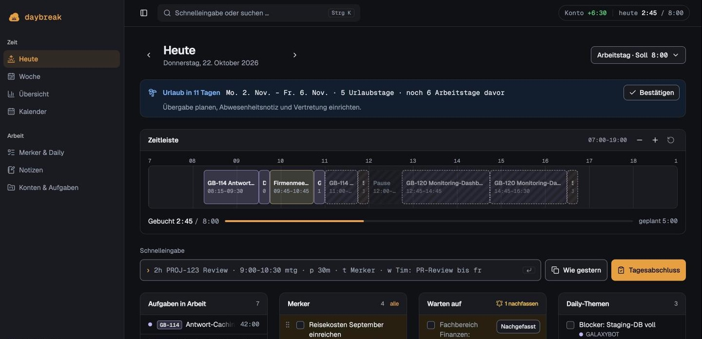
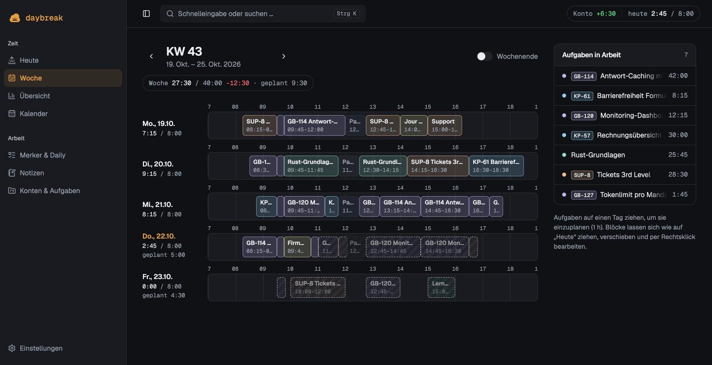
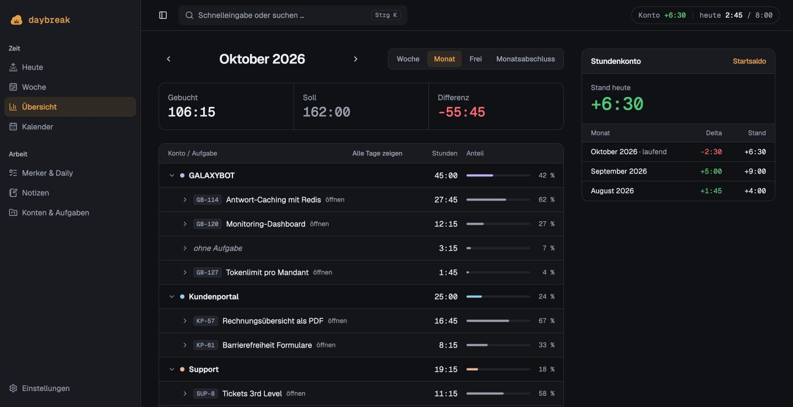

<h1 align="center">☀️ daybreak</h1>

<p align="center">
  <strong>Personal work dashboard: plan and book time, hours balance, vacation, reminders and notes in one place.</strong><br>
  Single user · self-hosted · one SQLite file
</p>

<p align="center">
  <a href="https://github.com/SleepyPxnda/daybreak/actions/workflows/ci.yml"></a>
  <a href="https://github.com/SleepyPxnda/daybreak/releases"></a>
  <a href="https://github.com/SleepyPxnda/daybreak/pkgs/container/daybreak"></a>
  <a href="LICENSE"></a>
</p>



Daybreak replaces slips of paper, Excel timesheets and the three note apps you would otherwise keep open side by side. Plan the day in the morning, book by keyboard during the day, close the day in the evening – and at the end of the month the hours per account are ready to be transferred into the company tool.

> [!NOTE]
> The UI is in German. Holidays come from [feiertagejs](https://github.com/sfakir/feiertagejs) (federal state selectable).

## Features

- **Today** (`/`) – day timeline on a 15-minute grid: drag, plan, book and split blocks; "Wie gestern" (copy yesterday) and day closing.
- **Quick input** (`Ctrl+K` / `⌘K`) – book, plan, create reminders, search and navigate with short commands, e.g. `2h GB-114 Review`, `9:00-10:30 mtg`, `plan 3h KP-57 morgen`.
- **Accounts & tasks** (`/accounts`) – account → task → blocks; blocks can also go directly onto an account (e.g. company meeting). Tasks have a key, an estimate and booked time.
- **Templates** – recurring appointments (daily, jour fixe …) with weekdays, interval and exceptions.
- **Hours balance** – target/actual/balance per day, month and in total, including holidays (federal state selectable) and a history chart.
- **Overview** (`/overview`) – booked time by account → task → day for a week, a month or a custom range; month closing for transferring into the company tool, optionally in decimal hours.
- **Calendar & vacation** (`/calendar`) – year calendar for vacation, half days, sick days, flex days and blockers; vacation account with entitlement, carryover and a notice before the next vacation.
- **Week** (`/week`) – timelines of all weekdays one below the other, planning by drag and drop, day and week totals with balance.
- **Reminders, daily topics, waiting for** (`/todos`) – small lists with a due date or follow-up date, linkable to tasks or accounts.
- **Notes** (`/notes`) – plain-text notes in three kinds (meeting, problem, info) with kind filter, tags, search and pinned notes on the "Heute" (today) page; each task page groups its linked notes by kind. Quick input: `np GB-114 Cache läuft voll`.

Just one dark, warm theme.

| Week | Overview |
|---|---|
|  |  |

## Quick start with Docker

Images for `linux/amd64` and `linux/arm64` are published to `ghcr.io/sleepypxnda/daybreak` with every GitHub release.

```yaml
# docker-compose.yml
services:
  daybreak:
    image: ghcr.io/sleepypxnda/daybreak:latest
    ports: ["3000:3000"]
    volumes: ["./data:/data"]
    environment:
      - TZ=Europe/Berlin
      - DAYBREAK_PASSWORD=a-long-password   # optional, see below
    restart: unless-stopped
```

```bash
docker compose up -d   # http://localhost:3000
```

> [!WARNING]
> Without `DAYBREAK_PASSWORD`, anyone with network access has full access to the data. Do not expose it to the internet unprotected.

Database migrations run automatically at startup. For a backup, a copy of `data/daybreak.db` is enough.

| Variable | Default | Meaning |
|---|---|---|
| `DAYBREAK_PASSWORD` | – | Enables Basic Auth (any username). Without a password the app is open – then run it only locally or behind a protected reverse proxy. |
| `DATABASE_URL` | `file:/data/daybreak.db` | Path to the SQLite file |
| `TZ` | `Europe/Berlin` | Time zone for day boundaries |
| `PORT` | `3000` | HTTP port |

Tags: `latest`, `X.Y.Z` and `X.Y` (e.g. `ghcr.io/sleepypxnda/daybreak:0.0.3`).

## Development

Requirements: Node 22+, pnpm.

```bash
pnpm install
pnpm db:seed   # optional: fill the DB with test data (empties it first!)
pnpm dev       # http://localhost:3000
```

| Command | Purpose |
|---|---|
| `pnpm dev` | Dev server |
| `pnpm test` | Vitest (business logic in `shared/utils/`) |
| `pnpm lint` / `pnpm typecheck` | ESLint / vue-tsc |
| `pnpm build` | Production build |
| `pnpm db:generate` | Generate a migration from `server/db/schema.ts` |
| `pnpm db:seed` | Create ~2 months of sample data around today |
| `docker compose up --build` | Build and start the production image locally |

The local database lives at `data/daybreak.db` (gitignored).

**Stack:** Nuxt 4 · shadcn-vue (Reka UI) · Tailwind CSS v4 · Drizzle ORM + SQLite (libsql) · date-fns · feiertagejs · zod · Vitest

### Project structure

```
app/          Nuxt frontend (pages, components, composables)
server/       API routes, DB schema and client, server utils
shared/utils/ Pure business logic (parser, target/balance, vacation …) – with tests
drizzle/      SQL migrations
docs/         Documentation per phase
scripts/      Dev scripts (seed)
```

## Documentation

- [`docs/`](docs/README.md) – usage, business rules, data model and API per phase
- [`docs/ARCHITECTURE.md`](docs/ARCHITECTURE.md) – architecture and decisions
- [`docs/SPEC.md`](docs/SPEC.md) – scope per area

## Release

A GitHub release with the tag `vX.Y.Z` builds and publishes the Docker image (`.github/workflows/docker.yml`). CI (lint, typecheck, tests, build) runs on every push.

## License

[MIT](LICENSE) © 2026 SleepyPxnda
